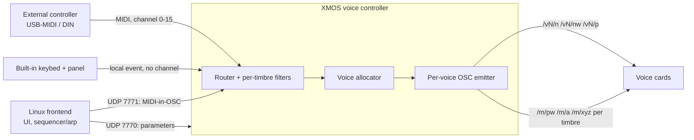

# one-synthesizer

Interoperability notes and tools for the Moog One: per-note MPE, the internal MIDI/OSC signal flow,
and an external parameter editor. Work in progress.

Pages: https://pnomolos.github.io/one-synthesizer/

- [Signal flow](https://pnomolos.github.io/one-synthesizer/signal-flow.html): how MIDI becomes
  per-voice OSC, how the built-in keyboard path differs from an external controller, and how
  per-note MPE fits in
- [Protocol](https://pnomolos.github.io/one-synthesizer/protocol.html): ports, MIDI-in-OSC,
  binary parameter records
- [Editor](https://pnomolos.github.io/one-synthesizer/editor.html): desktop editor and librarian

## The short version

As shipped, notes are sent per voice but bend, pressure and pad are sent once per timbre, so an
MPE controller's per-finger expression collapses into one value. The voice cards already accept
those messages per voice; the stock voice controller never sends them that way.

This project changes the voice controller so that one timbre accepts every MIDI channel, each
voice remembers the channel its note arrived on, and expression on that channel goes to that
voice alone. The voice cards are not modified.

## Status

| Track | State |
|---|---|
| Per-note MPE (pitch bend, pressure, slide) | All three axes verified on hardware; one unit, one firmware version |
| Editor / librarian | Full parameter surface and mod-matrix editing validated on hardware (every wire type, batched push, compound co-send, matrix routes applied by the engine, panel readback, librarian round-trip); effects not modelled yet |
| Microtuning | Cents verified on hardware by audio analysis; frontend resend shim; one unit, one firmware version. Combined MPE + microtuning image verified offline, not yet flashed; fixes a mono/legato re-sound defect in the standalone build |
| Mod matrix | Destination map, 23 of 35 source codes and squared/cubed transforms verified on hardware or against the instrument's own preset compiler; editable in the editor; remaining sources and the limit transforms still inferred |
| Protocol docs | Partial; panel plane undecoded |

See the [project log](https://pnomolos.github.io/one-synthesizer/log.html) for dated milestones.

Tested on system firmware 1.5.0, voice controller 2.1.2, voice cards 2.1.0. Source for each track
will be added as it is cleaned up.

## What will not be here

Moog firmware in original or modified form, or disassembly and string dumps of it. Anything
published for the MPE track will be a patch that operates on an image extracted from your own
instrument.

## Disclaimer

Independent project. Not affiliated with, endorsed by, or supported by Moog Music. "Moog" and
"Moog One" are trademarks of their owner, used only to identify the instrument. No warranty. Sending
arbitrary OSC to the voice controller, or modifying it, can leave the instrument unresponsive.
